<!-- Generated by scripts/readme.mjs from profile.config.mjs. Edit those, then run npm run render. -->

  <picture><source media="(prefers-color-scheme: dark)" srcset="assets/dark/hero.webp">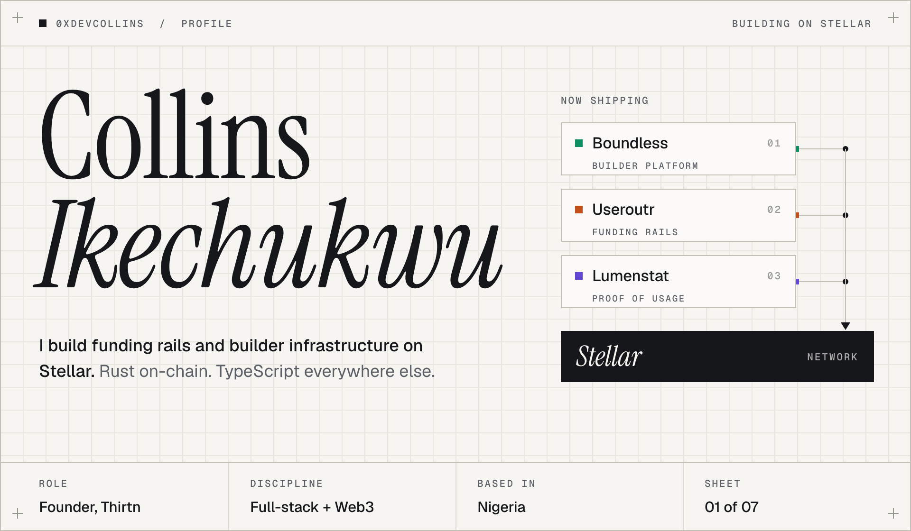</picture>

  <a href="https://boundlessfi.xyz"><picture><source media="(prefers-color-scheme: dark)" srcset="assets/dark/boundless.webp">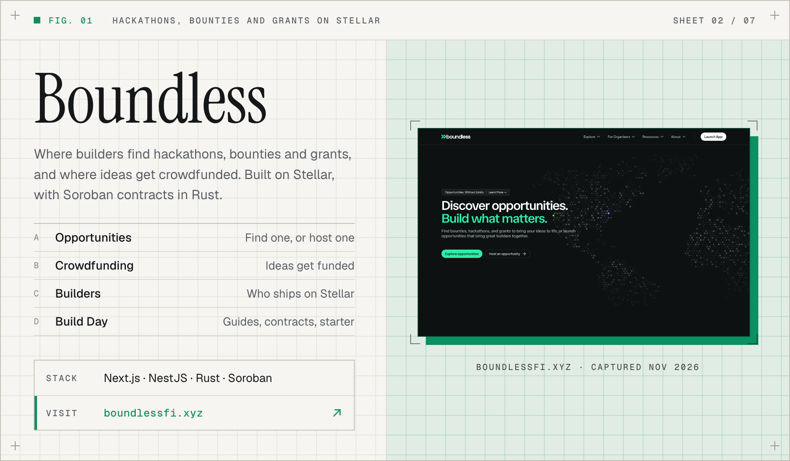</picture></a>

  <a href="https://www.useroutr.com"><picture><source media="(prefers-color-scheme: dark)" srcset="assets/dark/useroutr.webp">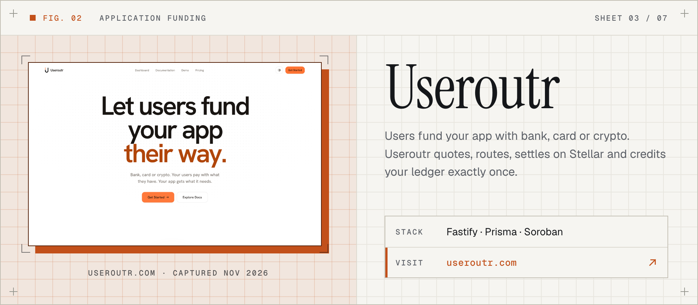</picture></a>

  <a href="https://lumenstat-site.vercel.app"><picture><source media="(prefers-color-scheme: dark)" srcset="assets/dark/lumenstat.webp">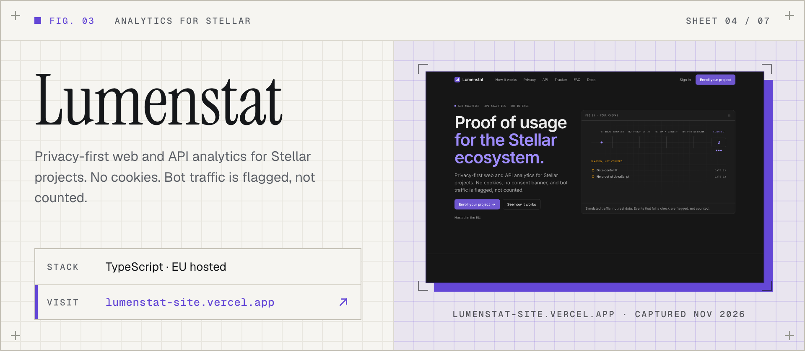</picture></a>

  <a href="https://github.com/sumasrms"><picture><source media="(prefers-color-scheme: dark)" srcset="assets/dark/more-sumasrms.webp">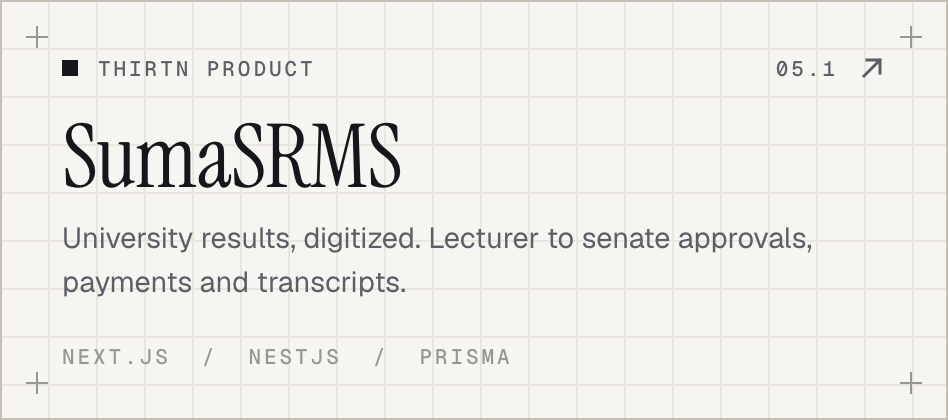</picture></a>
  <a href="https://github.com/Threadify-me"><picture><source media="(prefers-color-scheme: dark)" srcset="assets/dark/more-threadify.webp">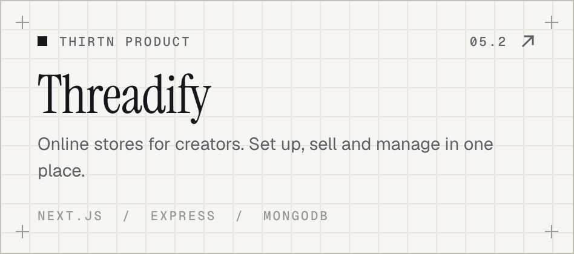</picture></a>
  <a href="https://github.com/0xdevcollins/stellar-dvn"><picture><source media="(prefers-color-scheme: dark)" srcset="assets/dark/more-stellar-dvn.webp">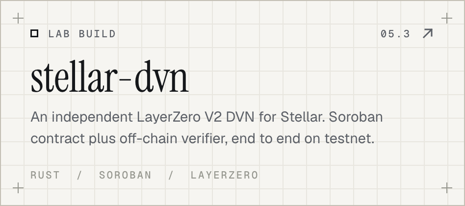</picture></a>
  <a href="https://github.com/0xdevcollins/moat"><picture><source media="(prefers-color-scheme: dark)" srcset="assets/dark/more-moat.webp">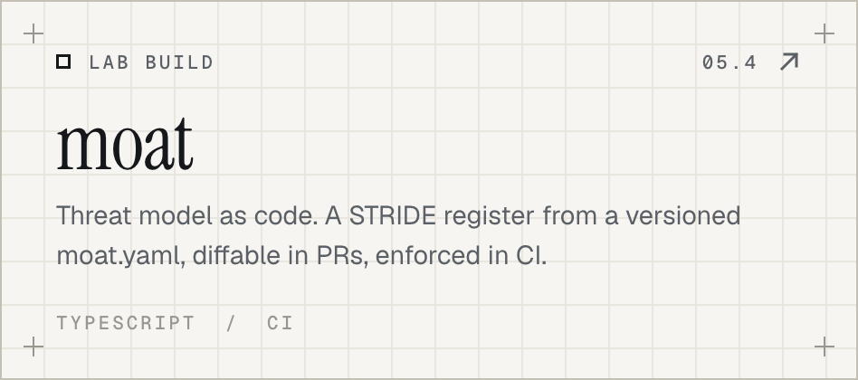</picture></a>

  <picture><source media="(prefers-color-scheme: dark)" srcset="assets/dark/stack.webp">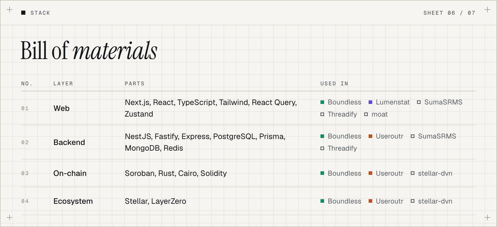</picture>

  <picture><source media="(prefers-color-scheme: dark)" srcset="assets/stats-dark.svg"></picture>

  <a href="https://github.com/0xdevcollins"><picture><source media="(prefers-color-scheme: dark)" srcset="assets/dark/c-github.webp">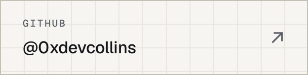</picture></a>
  <a href="https://x.com/0xdevcollins"><picture><source media="(prefers-color-scheme: dark)" srcset="assets/dark/c-x.webp">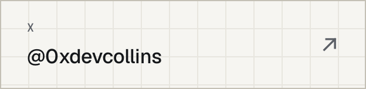</picture></a>
  <a href="https://www.linkedin.com/in/collins-chikangwu/"><picture><source media="(prefers-color-scheme: dark)" srcset="assets/dark/c-linkedin.webp">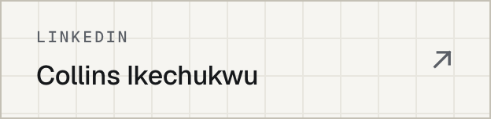</picture></a>

